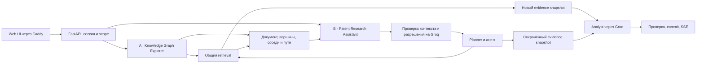
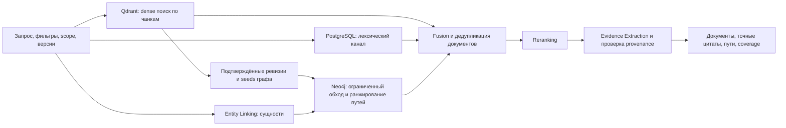
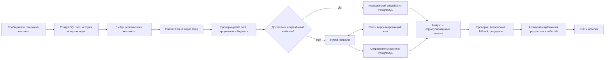
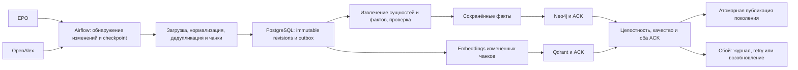
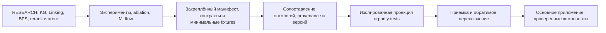

# Целевая архитектура

Интеллектуальный агент исследует технические идеи по патентам и научным публикациям. Knowledge Graph Explorer и Patent Research Assistant работают на общей инфраструктуре поиска. Выводы ограничены найденным корпусом и служат предварительному техническому исследованию. Срез работающих компонентов и критерии MVP описаны в [окончательном плане](FINAL_PROJECT_PLAN.md).

## Компоненты

| Компонент | Ответственность |
| --- | --- |
| React / TypeScript / Vite | Режимы, чаты, документы, источники и интерактивный граф |
| Caddy и FastAPI | HTTPS, сессии, ownership, версионированные API, SSE |
| Backend и analysis worker | Модульный монолит на Python. Transactional jobs, Planner, ограниченная агентная оркестрация, проверка и публикация |
| Groq / InferenceProvider | Генерация по ролям: Planner, агент, Analyst, extractor по необходимости, offline Judge. Локальные модели применяются для NER, embeddings и neural reranking |
| Retrieval | Лексический канал PostgreSQL, dense Qdrant, Entity Linking, Neo4j, fusion, reranking и Evidence Extraction |
| PostgreSQL | Постоянные аккаунты, приватные чаты, идея и версии, runs, snapshots, документы, факты публичного корпуса, outbox и поколения индекса |
| Neo4j и Qdrant | Восстанавливаемые версионированные проекции графа и векторов чанков |
| Redis | Восстановимые кэши retrieval/rerank/graph и вспомогательные счётчики. Сбой кэша оставляет durable историю доступной |
| Airflow | Офлайн-обновление публичного корпуса с повтором, проверкой и публикацией поколения |
| MLflow | Манифесты и метрики экспериментов RESEARCH. Работа приложения не зависит от MLflow |

Базовая топология — Docker Compose на одном хосте, Caddy как единственная внешняя точка входа. Браузер не имеет прямого доступа к Neo4j. Сервер проверяет scope и выбирает версию проекции. [Развёртывание](DEPLOYMENT.md) · [Безопасность](SECURITY.md)

## Онлайн-поток и общая поисковая инфраструктура

Реализованная база — [индексация чанков](../src/app/services/indexing.py), [поиск](../src/app/services/retrieval.py), RRF, reranking документов и evidence pack. Qdrant использует отдельный вектор для каждого чанка, а не гарантированный единый вектор на документ. Лексический канал сейчас ищет по метаданным PostgreSQL. Существующий Neo4j-канал использует признаки для поиска кандидатов. Полный Linking, bounded path retrieval с выбором разрешённых переходов и расширение от результатов dense-канала вводятся по [backlog](../TASKS.md). Fusion объединяет каналы и сохраняет coverage. При недоступном индексе ограничения явно отражаются в результате.

Explorer запускается и читает данные без генерации. Нажатие на документ открывает его разрешённую ревизию, вершины и доказательства. При передаче узла, документа или пути агент получает ссылку на контекст с версией графа, которая повторно проверяется сервером. Текущий run-scoped граф и новый самостоятельный режим сосуществуют с различным scope. [Схема графа](GRAPH_SCHEMA.md) · [API](API_CONTRACTS.md)

## Агент, память и публикация

Доверенная оболочка проверяет версии и ownership, применяет patch через CAS и выполняет только разрешённые операции. Существенное изменение идеи или запрос новых фактов приводит к новому поиску. Вопрос о сохранённом источнике использует прежний snapshot и idea_version, даже после смены графа; текущая версия чата сохраняется. Узлы идеи формируются в приватном представлении конкретного пользователя. Сводки помогают выбрать контекст, а исходные сообщения и результаты остаются в PostgreSQL. [Память](MEMORY_AND_CACHE.md) · [Модель данных](DATA_MODEL.md)

Сохраняются durable jobs, lease fencing, idempotency, отмена и один нетерминальный запуск на чат. Статусы `pending/running/completed/failed/cancelled` отделены от outcome. Проверенный fallback — `completed/safe_fallback`; успешный пустой поиск — `completed/no_evidence`; полная недоступность нужных каналов — `failed`. Для невалидной структуры предусмотрен один repair в пределах общего бюджета. Готовый ответ, публичный ход анализа и terminal SSE записываются одной транзакцией. До неё виден фактический progress. Reconnect восстанавливает сохранённые данные без нового inference. Raw reasoning, drafts и сырой поток модели не покидают адаптер и память обработки. [Контракт LLM](LLM_CONTRACTS.md) · [Контракт SSE](API_CONTRACTS.md#sse-и-публикация)

## Офлайн-поток Airflow

Задачи Airflow используют существующие source adapters, ingestion, outbox и проекторы; online analysis jobs остаются в приложении. Идемпотентность опирается на source/external ID, hash содержимого и версии обработки. Опубликованное поколение сохраняется при частичном сбое. QA проверяет точные строки доказательств, membership, ожидаемые проекции и счётчики до активации. Retry возобновляет незавершённые стадии и сохраняет прошлый watermark до подтверждения достаточного прогресса. Массовое переиндексирование выполняется отдельным управляемым процессом при смене контракта или embedding-модели. [Модель данных](DATA_MODEL.md#индексация-и-чтение) · [Развёртывание](DEPLOYMENT.md)

## Перенос из RESEARCH

Совместимость текущего Neo4j с новым KG устанавливается до переноса. Проверяются старые и новые ID, направления и типы, допустимые нормализации, источники, revision/chunk spans, namespace/generation и исторический API. Для непреобразуемых записей сохраняется отчёт о пропусках. Выпуск проверяется на отдельной проекции и предусматривает возврат совместимого указателя без удаления старых данных. [Схема и допуск](GRAPH_SCHEMA.md) · [Решения](DECISIONS.md#adr-013--собственный-graph-rag-и-перенос-из-research)

## Наблюдаемость и проверка качества

`/health/live` проверяет процесс, текущий `/health/ready` проверяет доступ к таблице очереди PostgreSQL. Health по worker heartbeat, индексам, Groq и Airflow расширяется отдельно. Телеметрия содержит разрешённые коды и счётчики по стадиям, модель/роль, вызовы, токены и стоимость Groq, latency, cache hit/miss, ошибки, timeout и состояние офлайн-задач. При неизвестном usage пишется `null` с причиной. Технический журнал не включает пользовательские тексты, промпты, секреты и raw reasoning.

Эксплуатационная latency отделяется от model TTFT и офлайн-измерений. Judge вызывается только в evaluation через Groq. Сопоставимые запуски фиксируют код, данные, версии проекций, конфигурацию и манифест качества. [Оценка](EVALUATION.md)
