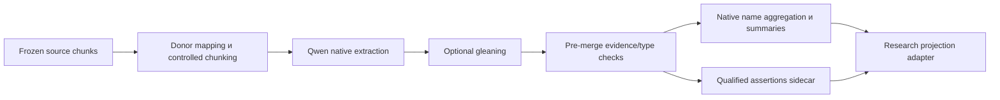
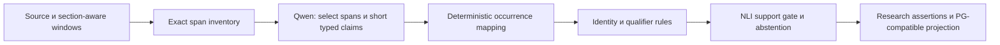
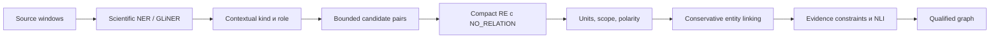
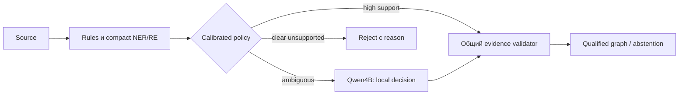
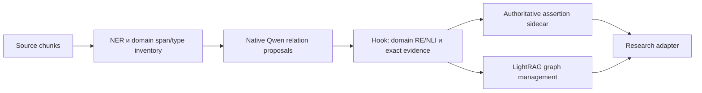
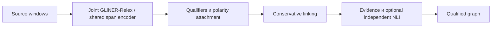

# Архитектуры A–F

Все pipelines в этом документе — **проект будущих экспериментов**, без реализации. Их precision, recall и CPU/RAM — `NOT_MEASURED`. Исходная Qwen3.5 4B и её digest фиксированы в [аудите](CURRENT_PIPELINE_AUDIT.md). Ни один вариант не требует перехода на большую generative LLM.

## 1. Общий предметный контракт

Дополнение от 2026-10-21: все A–F используют общий [контур наблюдаемости и защит](OBSERVABILITY_SECURITY_LANGUAGE_ARCHITECTURE.md). MLflow получает только разрешённые metrics/metadata; guard policy фиксируется для сравнения. RU → EN language adapter находится в контуре запроса и не меняет английские source spans или offline ontology. Он выбирается отдельным экспериментом при фиксированном графе, затем фиксируется для downstream сравнения A–F. Это проект архитектуры, без реализации.

Сравниваются разные алгоритмы, но одинаковое значение выходных данных. Общий контракт не требует одинакового внутреннего graph database.

- **Source/Revision/Chunk**: immutable evidence, hashes, section и язык; Python Unicode codepoint offsets `[start,end)`. Tokenizer offsets и UTF-16 browser offsets не смешиваются с ними.
- **Mention**: точный span и contextual type/role. `NH3` как вещество и его роль analyte различаются. Source string не нормализуется ради удобства matching.
- **TechnicalConcept**: stable semantic identity, kind, vocabulary/normalizer version; aliases имеют отдельные решения и evidence. Само mention не доказывает, что concept использован в устройстве.
- **Assertion**: endpoints (mention/device instance), directed controlled predicate, polarity, modality/status, conditions, properties/value/unit, evidence spans и semantic-support decision. Concept-level projection производна от assertions.
- **IdentityDecision**: `SAME/RELATED/BROADER/NARROWER/DIFFERENT/ABSTAIN`, scope, evidence и classifier/rules identity. Only SAME может объединять concepts; RELATED и hierarchy остаются рёбрами.

Минимальные proposed predicates: `USED_IN`, `DETECTS`, `OPERATES_AT`, `HAS_PROPERTY`, `PRODUCED_BY`, `ADSORBS`, `MEASURED_UNDER`. `MENTIONS` — source attribution, а не technical relation. Domain/range constraints проверяются до publication. Это **research ontology**, не предложение сейчас менять production enums/migrations.

Численное свойство лучше хранить n-ary assertion: device/material + property + value/range + unit + condition + method + source. Простой triple `graphene — response → 20%` без device, concentration и experiment scope недостаточен. Несколько противоречивых source assertions сохраняются раздельно; новое исследование не стирает старый факт по temporal invalidation.

Canonicalization не должна соединять все «sensor» как один физический device. Тип устройства можно разделять между документами, а instance экспериментальной установки остаётся scoped к source/revision. Generic concepts сохраняются как generic, но их влияние на document connectivity учитывается отдельно.

### Общие evidence gates

1. Document/revision/chunk membership и hash совпадают.
2. Каждый surface и quote — exact slice исходного текста; повторное вхождение должно иметь однозначный occurrence anchor.
3. Entity kind/role, relation direction и допустимые endpoints согласованы.
4. Qualifiers/polarity имеют evidence; missing value — `UNKNOWN`, не invented default.
5. Semantic support оценивается отдельно; неполное evidence означает `ABSTAIN`, а не positive fact.
6. Identity merge проходит собственный gate и cannot-link checks. Graph storage не переопределяет результат по похожему имени.

Общие gates используются для сопоставимости, но отдельно публикуется качество **raw proposals** и **accepted assertions**. Иначе один чрезмерно строгий validator может скрыть различия extractors и дать искусственно высокую precision при нулевом recall.

## 2. Единый пример

Иллюстративный фрагмент, **не результат запуска и не новый test fixture**:

> A graphene sensor detects NH3 at 25 °C. The sensor does not detect NO2 at 25 °C. Platinum electrodes were not used in the sensor.

Желаемая интерпретация: scoped sensor instance; material graphene; chemical concepts NH3 и NO2 с analyte roles; temperature condition 25 °C; platinum electrodes как device component с `not_used` status. Positive `DETECTS(sensor,NH3)` и negative `DETECTS(sensor,NO2)` имеют собственные evidence/condition. `USED_IN(platinum electrodes,sensor)` только с negative polarity. Общий noun `sensor` не доказывает SAME с другим устройством из другого документа. Explicit repeated noun `The sensor` требует локальной coreference, которая также фиксируется.

## 3. A — Native LightRAG + domain configuration + pre-merge validation

**Алгоритм.** Native LightRAG предлагает entities/types/descriptions и relations. Domain type guidance и prompt задают desired predicates, source snippets, polarity и conditions. Hook до merge фильтрует unsupported entities/relations, проверяет exact occurrence и переносит проверенные claims в внешний research result. После этого LightRAG поддерживает собственный граф; summaries служат индексными описаниями. Для строгого сравнения adapter берёт assertions до lossy merge, не восстанавливает их из summary.

**Модели/проходы.** Та же Qwen для extraction и optional summaries; gleaning 0/1 — отдельная ablation. Первичная semantic validation — deterministic constraints и независимая offline human оценка; компактный NLI допускается как явно обозначенный A+NLI arm, чтобы A не превратился незаметно в E. Prompt instruction не считается validation.

**Concept и linking.** Native name aggregation не ontology-aware canonicalization. Domain canonical concepts строятся sidecar адаптером из validated spans с conservative lexical identity; native keys используются только как donor references. Hook обязан отбрасывать dangling edges после entity filtering. Отношения donor агрегируются по паре endpoints, в pin встречается sorting pair keys: нельзя считать native merged edge достаточным для directed, multi-relation, polarity-sensitive claim. Нужен pre-merge record.

**Qualifiers/negation/provenance.** Расширенные поля не гарантированно проходят стандартный native parser. Если поддерживаемый prompt/parser не позволяет lossless export, A для этой части получает `UNSUPPORTED_CAPABILITY`; выводить пустые qualifiers как «отсутствующие» запрещено. Минимальный adapter может разобрать ограниченный closed-format payload в description, но это integration work и отдельная version. Санитизированный donor text сопоставляется с исходным chunk; при неоднозначности mapping отказ.

**Пример.** Qwen может предложить sensor/NH3/NO2 и textual relations. A должен удержать две разные DETECTS assertions с opposite polarity и 25 °C; native positive edge без отрицания не проходит gate. Если export до merge отсутствует, пример считается failed capability, даже если graph visualization выглядит связным.

**Обучение/gold.** Fine-tuning не обязателен. Нужны source gold, hard-negative identities, typed predicates, qualifiers и native→research mapping review. **CPU/RAM:** генерация на каждый chunk плюс gleaning/retries/summaries, graph/vector copies; нагрузка `NOT_MEASURED`. **Интеграция:** средняя/высокая — существующий chunk-only no-generation adapter нельзя просто включить. **Основные риски:** free descriptions, homonym merge, потеря direction/conditions, source mapping и hidden summary cost. **Гипотеза:** native relation discovery даст больше candidate recall, но precision gate может сильно уменьшить выход.

## 4. B — Improved Source-grounded Hybrid

**Алгоритм.** Подготовить sentence IDs, exact span candidates из dictionary/noun phrases; candidate list не должен быть жёстким пределом recall: Qwen может указать новый exact surface и occurrence anchor. Qwen возвращает компактные span selections, types/roles и relations с endpoint IDs. Не генерирует UUID, offsets, повторяющиеся длинные quotes и summaries. Код вычисляет offsets по исходному тексту; затем закрытые validators проверяют relation/qualifier schema, canonicalization и support.

**Модели/проходы.** Qwen вызывается на каждый admitted window для extraction; MiniLM или DeBERTa проверяет accepted claim candidates, batch по длине. Один основной generative pass; второй repair разрешается только как одинаково учтённый failure policy. Numeric/units extraction, hashing и offsets детерминированы. Это отличается от D: нет routing, позволяющего большинству windows обходиться без Qwen.

**Concept и linking.** Source lexical anchor отделён от canonical concept. Exact chemistry-aware dictionary/abbreviation links безопасно добавляются только с обоснованием; не требуется менять surface на canonical string. Для иных aliases — `ABSTAIN` либо calibrated pair classifier как отдельная ablation. Base identity не включает temperature; claim identity включает conditions и source scope.

**Qualifiers/negation/provenance.** Qwen выбирает closed polarity/status и evidence anchor; deterministic parser извлекает values/units; NLI проверяет qualified assertion целиком. Повторяющийся surface разрешается sentence/occurrence ID, не первым `find()`. Source offsets никогда не вычисляются на нормализованном тексте. Сложная cross-sentence scope без достаточной поддержки не публикуется.

**Пример.** Qwen возвращает ссылки на `NH3`, `NO2`, `25 °C`, sensor mentions и three relation records; offsets добавляет код. `Platinum electrodes` не становится положительным USED_IN после удаления `not`. NLI получает отдельно positive NH3 и negative NO2 hypotheses. `room_temperature` не подставляется вместо 25 °C без явной ontology equivalence policy.

**Обучение/gold.** Fine-tuning необязателен; NLI thresholds требуют gold, включая correct spans/incorrect meanings. **CPU/RAM:** Qwen decoding остаётся основным расходом; добавляется verifier, но short outputs могут его компенсировать — гипотеза. **Интеграция:** средняя, reuse EvidenceChunk/PG/projection; новые research claims не встраиваются сейчас в production. **Риски:** quote-copy omissions, NLI domain shift, ложная уверенность за счёт фильтрации recall, большое число windows. **Гипотеза precision/provenance:** самый прямой контроль error path и наименьший перенос storage semantics.

## 5. C — Small Classifier Pipeline

**Алгоритм.** GLiNER-small даёт zero-shot starting spans; domain head на SciBERT/MatSciBERT — будущий supervised endpoint. Contextual type/role определяется joint NER head или отдельным classifier только при доказанной необходимости. Type/clause-compatible pairs поступают в relation classifier с `NO_RELATION`. Numeric qualifiers и negation scope извлекаются rules/parser; сложные cases получают abstention. No generative calls.

**Модели/проходы.** NER encoding/window, RE marked-pair encoding для P пар либо shared span head, optional NLI на R claims. GLiREL — быстрый zero-shot RE comparator с отдельной лицензией, не скрытая замена supervised head. Все дополнительные passes и resident weights учитываются. Для строгого C не добавлять Qwen как неучтённый fallback.

**Concept и linking.** Dictionaries, local abbreviations, existing embeddings для top-k candidate identities, компактный SAME classifier на calibrated pairs; uncertain identities остаются раздельными. Сохранять cannot-link chemical constraints и cluster consistency. `sensor` generic type не сливает device instances.

**Qualifiers/negation/provenance.** Все spans исходные; scope classifier/rules присваивают status и conditions. Если NER не нашёл qualifier, relation нельзя принимать как безусловную: при наличии unresolved condition cues — abstention. Unit parser не решает, к какому устройству относится число; это RE/attachment gold.

**Пример.** NER выделяет sensor, graphene, gases, temperature и electrodes. Candidate filter не исключает negative relations. RE различает DETECTS и USED_IN, scope rules отмечают два отрицания. При неразрешённой coreference `The sensor` C сохраняет mentions, но abstains на соответствующем assertion; эту потерю считает recall.

**Обучение/gold.** Zero-shot pilot возможен; strong target RE head, role classifier и identity head вероятно потребуют доменной разметки, необходимость устанавливает pilot. Нужны exhaustive spans, entity groups, directed relations, negatives, condition attachment. **CPU/RAM:** нет autoregressive decoding, но P может быть квадратичным; несколько encoders могут суммарно быть дороже одного короткого Qwen pass. **Интеграция:** средняя/высокая из-за training/calibration и error propagation. **Риски:** upstream NER omissions, domain shift, pair explosion, разные tokenization offsets. **Гипотеза:** лучший CPU-кандидат при ограниченных pairs и приемлемом candidate recall.

## 6. D — Selective LLM Cascade

**Алгоритм.** Начальная ветка C выдаёт spans, candidate claims и uncertainty features. Маршрутизация использует calibrated margin, type conflicts, unresolved coreference, rule/classifier disagreement и domain/OOD flags. High-support cases проходят common gates; ambiguity batch поступает Qwen с локальным контекстом и closed choices, включая `NONE/INSUFFICIENT`. Модель может предложить missing exact span, но не отменить deterministic mismatch или chemical cannot-link.

**Пропуски и routing.** Confidence на найденных candidates не видит отсутствующие entities. Поэтому нужны отдельные missing-candidate cues: technical dictionary term без span, numerical result без attachment, sentence with relation verb и zero pairs. Небольшой заранее заданный audit sample high-confidence/zero-output windows нужен для оценки routing recall; на стадии эксперимента его стоимость записывается отдельно, а sampling не использует test gold.

**Модели/проходы.** Compact models C + та же Qwen только для доли `a` uncertain windows/pair groups; один общий verifier. Qwen решает relation/type/coreference, а не генерирует целый graph description. Hard rules, offsets, units, dedup детерминированы.

**Concept/linking/false positives.** Как C; спорные aliases Qwen может классифицировать, но SAME принимается только по calibrated identity policy и независимым constraints. Self-consistency нескольких Qwen votes не считается независимым evidence.

**Qualifiers/provenance.** Unresolved scope направляется в Qwen; возвращаются evidence span IDs и typed fields. Итог всё равно проверяется exact anchoring + semantic gate. Если budget exhausted — `ABSTAIN/BUDGET_EXHAUSTED`, не model-empty.

**Пример.** Дешёвая ветка находит explicit NH3 claim. Если не уверена, что `The sensor` относится к тому же instance и отрицание касается DETECTS, отправляет только второе предложение с antecedent. Qwen выбирает coreference и negative relation; common validator проверяет оба evidence spans. Platinum not-used branch может быть решён строгим pattern без генерации.

**Обучение/gold.** C gold плюс routing labels: где cheap branch ошибается и где Qwen действительно исправляет. Маршрутизатор обучается/настраивается на dev/calibration, не на holdout. **CPU/RAM:** выигрыш только при небольшом `a`, достаточно дорогом full generation и умеренном loading overhead. **Интеграция:** высокая, но общие DTO C и B позволяют избежать полного переписывания. **Риски:** уверенные ошибки остаются без escalation, model switching, nonstationary thresholds, дорогой fallback почти на всё. **Гипотеза:** лучший баланс после калибровки; до неё D не превосходит B/C автоматически.

## 7. E — LightRAG + Domain Classifiers

**Алгоритм E1.** Compact NER формирует inventory; native LightRAG Qwen предлагает relations/descriptions с domain prompt. `kg_extraction_validator` проверяет candidate types/endpoints и NLI support, canonicalization делается вне native name merge. E1 измеряет пользу classifiers при сохранении native generative candidate discovery. Это отличается от A validation-моделями и от D отсутствием selective skipping native generation.

**E2 как отдельная поздняя ablation.** Полностью external classifier extraction → `ainsert_custom_kg`/projection adapter. Это экономит native extraction calls, но по IE алгоритму приближается к C/F; нельзя выдавать один и тот же extractor с другой БД за независимое доказательство accuracy. Сравнивать E2 с C при одинаковых proposal records только по storage/integration overhead и information preservation. Hook после Qwen сам по себе не реализует E2.

**Модели/генерация.** E1: GLiNER, Qwen per chunk, NLI и optional compact RE checker; native summaries отдельно. E2: no extraction generation, summary policy фиксируется. **Concept/relations:** validated source claims authoritative, donor merge только derived index. Native source_id не заменяет revision/occurrence evidence.

**Qualifiers/negation/provenance.** External sidecar сохраняет directed multi-relations и scopes до merge, duplicate names не сливают разные conditions. Input sanitizer mapping такой же, как A. При custom KG учитываются уже зафиксированные проектом provenance caveats; одному source alias не поручается хранить несколько source occurrences.

**Пример.** GLiNER даёт spans; Qwen предлагает DETECTS для обоих газов. Domain NLI отклоняет positive NO2, но negative claim принимается только если он действительно присутствует в proposals и grounded. Verifier не вправе молча создать missing relation; corrections должны быть отдельным extractor step с counted cost. Platinum positive USED_IN блокируется scope validator.

**Обучение/gold.** Как C для classifiers плюс native mapping/source-support review. **CPU/RAM:** E1 добавляет encoder costs поверх генерации и summary, вероятно самый дорогой вариант на простых abstracts; это гипотеза. **Интеграция:** высокая — два graph representations и version identities. **Риски:** двойная обработка, сохранение неверной информации в summary после фильтра, потеря assertion details при export. Выбирать E только если native discovery или incremental management даёт измеримую пользу.

## 8. F — Joint Span/Relation Encoder + assertion rules

**Алгоритм.** Один shared encoder строит entity spans и span-pair relations. Первый ready checkpoint — GLiNER-Relex base; GLiNER2 base сравнивается как alternative implementation. В дальнейшем SpERT-style head на MatSciBERT возможен только как training arm. Общий context не переобрабатывается отдельной BERT-моделью для каждой пары; pair scoring всё равно остаётся, его стоимость не нулевая.

**Модели/генерация.** Joint encoder и optional NLI, без generative LLM. Rules обрабатывают values/units; qualifiers связываются с relation instances. **Concept/linking:** как C, independent dictionary/identity policy, stable concept vs source instance разделены. **False positives:** shared representations не снимают необходимость NO_RELATION, type constraints, chemical cannot-link и abstention.

**Пример.** Один encoding предлагает NH3/NO2/sensor spans и DETECTS relations. Положительная NO2 proposal не становится fact: negative cue/condition attachment проверяется отдельно. Joint output без поля polarity дополняется evidence-based scope step, иначе статус unsupported; не заполняется default positive.

**Обучение/gold.** Zero-shot ready models позволяют screening; для supervised domain joint head нужны совместные entity/relation annotations. **CPU/RAM:** меньше repeated encoding, но span/pair tensors, labels и long windows увеличивают memory. **Интеграция:** средняя; parsing/offset adapter и scope stage обязательны. **Риски:** correlated entity/RE errors, max span width, emerging implementation API, непроверенные CPU ONNX kernels. **Гипотеза:** F может вытеснить C в shortlist после дешёвого head-to-head screening, но сейчас данных нет.

## 9. Обновления и междокументное объединение

Для всех вариантов proposed update protocol одинаков: content revision → invalidate только derived outputs этой revision → reuse unchanged chunk extraction по exact hash **и полной model/config/schema identity** → rebuild affected aliases/assertion aggregates → publish versioned graph snapshot. Удаление source снимает только его evidence; assertions с другими источниками остаются. Graph facts должны восстанавливаться без inference.

Cross-document entity merge выполняется только после локального extraction: одинаковое chemical identity допустимо, одинаковый device label без identity evidence — нет. Source disagreement хранится на claim уровне; conditions и source roles не исчезают при concept merge. Generic hubs и graph density — диагностические характеристики, не оптимизируемая целевая функция.

Контракты adapters и честное сравнение: [EVAL001_COMPARISON_DESIGN](EVAL001_COMPARISON_DESIGN.md). Compute model: [PERFORMANCE_ANALYSIS](PERFORMANCE_ANALYSIS.md).
