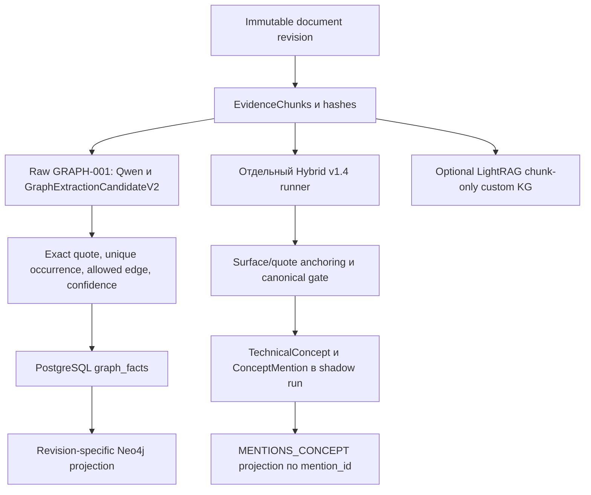

# Аудит текущего offline pipeline

Дата: 2026-10-19. Все выводы ниже получены чтением; существующие scripts, приложения и tests не запускались. Начальное рабочее дерево было чистым. HEAD `868bccc66f57bb6e7ceb49345b148cde587fb9f4`; последние изменения: `43e7adf` — EVAL-001, `9634766` — исходные Ruff/mypy blockers, `4875379` — isolated zero replay, `8fb0326` — canonical identity gate и diagnostics.

## 1. Источники и границы

Прочитаны релевантные разделы [TASKS](../../../TASKS.md), [ARCHITECTURE](../../ARCHITECTURE.md), [GRAPH_SCHEMA](../../GRAPH_SCHEMA.md), [DECISIONS](../../DECISIONS.md), [EVALUATION](../../EVALUATION.md), код ingestion/extractors/validators/projection/adapter и EVAL-001. Указания старого TASKS о tests/commit/push не применялись: текущее пользовательское задание явно запрещает их.

Основной historical snapshot: `5b80378fa2d8312951446fcbb3ada7994d775f13d452ff08fd415377a5fcade0`, 100 OpenAlex documents/revisions, **136 abstract chunks**. Патентов и full-text scientific articles в этой выборке нет. Это установлено [GRAPH_CORPUS_AUDIT](../GRAPH_CORPUS_AUDIT/diagnosis.md), а не предположено по теме диплома. Предыдущие проверки БД пересказываются как исторические: live consistency сегодня `UNKNOWN`.

## 2. Реальные потоки

Raw, GRAPH-002 canonicalization, Hybrid и optional LightRAG нельзя считать одной последовательно выполненной native KG системой.

### Подготовка и chunking

В [ingestion.py](../../../src/app/services/ingestion.py) `_split_points`, `_pieces`, `_chunks`, `_chunk_row` сохраняют исходные section slices и SHA-256. Default `chunk_size=1200` — **символы Python Unicode, не токены**. Используются границы предложений/абзацев и разделение длинных фрагментов по пробелу. Это не патентный claim parser и не tokenizer-aware admission control. Audit подтверждал покрытие nonwhitespace abstract текста, но не качество semantic boundaries. Возможные проблемы decimal points, abbreviations, claim dependencies требуют будущей разметки; текущая частота `NOT_MEASURED`.

### Raw GRAPH-001

[graph_index.py](../../../src/app/services/graph_index.py) `InferenceGraphExtractor` генерирует `edge_type, target_text, quote, confidence`; IDs/offsets добавляет код. `enrich_graph_candidates` принимает только `DISCLOSES_FEATURE`, требует нормализованный target внутри quote и **ровно одно** точное вхождение quote среди input chunks. Значит extractive-first enrichment частично уже существует; перенос этого принципа в Hybrid не является совершенно новой идеей.

`GraphExtractionCandidateV2` ограничивает target 160 символами, quote 512. `_validated_facts` повторно проверяет chunk/revision и allowed ontology; missing/invalid drafts могут отбрасываться. `GraphIndexingService` сохраняет facts в PostgreSQL, Neo4j восстанавливается по persisted facts без нового inference. Ключи документов включают revision. Это полезная основа для всех альтернатив, а не узкое место, требующее замены БД.

Raw `TechnicalFeature` смешивает атомарные concepts, qualified phrases и целые propositions. Исторический аудит 409 labels выявил 68 смешанных kinds, 36 context-dependent labels и три обрезанных labels. Это AI analytical annotation, не human gold. `DISCLOSES_FEATURE(document, phrase)` не эквивалентен `DETECTS(device, analyte)`.

### GRAPH-002 и CAL

Shadow entity resolution не меняет raw facts и production retrieval. Candidate retrieval по embeddings уменьшает перебор, но не доказывает SAME. [CAL selected contract](../../validation/GRAPH-002-CAL/selected_contract.json) содержит `selected_threshold=null`, `acceptance_gate_passed=false`: выбор 3-class как менее плохого кандидата нельзя интерпретировать как прошедшую калибровку.

На целенаправленно выбранных 143 парах: 3-class SAME precision = 19/56 ≈ 0.3393; 5-class = 16/49 ≈ 0.3265. В артефакте 3-class `false_merge_rate=37/143`; это доля ошибочных merges **от всех рассмотренных пар**, а не 37/56 от принятых merges. Для нового протокола оба знаменателя должны быть явными. Эти цифры не являются качеством encoder cross-encoder или универсальным пределом canonicalization: Tev1 здесь 4B generative classifier с конкретным prompt и смещённой выборкой. [Benchmark summary](../../validation/GRAPH-002-CAL/benchmark_summary.json).

### Hybrid v1.4

[technical_concepts.py](../../../src/app/services/technical_concepts.py) определяет 12 concept types; mention хранит canonical name, surface, quote, offsets, произвольный `qualifiers` dict и nullable confidence. `concept_identity = (concept_type, normalized canonical_name)`; qualifiers остаются на mention.

В [hybrid_concept_backfill.py](../../../scripts/hybrid_concept_backfill.py) отдельный prompt на chunk просит до 12 mentions, короткую exact quote (prompt limit 320), Unicode offsets и canonical name. Output budget 2048; повтор 3072 только после output-limit. `validate_or_reanchor_draft` вычисляет end и восстанавливает start при единственном exact occurrence. При повторных вхождениях и неверном предложенном start — отказ. Authoritative chunk/revision IDs берутся из локального `EvidenceChunk`.

После `8fb0326` canonical name должен совпадать с surface после NFKC/casefold/punctuation normalization. Это закрывает известную подмену generic surface конкретным газом, но также отвергает корректные нелексические aliases. Проверки concept type, роли, truth, relation entailment и qualifier semantics отсутствуют. Нормализация пунктуации сама не является химическим canonicalizer: формулы, заряд, стехиометрия и обозначения требуют отдельной политики; наличие новых false collisions не измерено.

Фактическая модель из [models.yaml](../../../config/models.yaml) и констант runner: **`qwen3.5:4b-q4_K_M`**, digest **`2a654d98e6fba55d452b7043684e9b57a947e393bbffa62485a7aac05ee4eefd`**. Не сокращать это до Qwen3 4B при воспроизведении. Сохранённый replay наблюдал Ollama 0.35.0 и effective context 4096. Сегодняшний runtime не проверялся. Исторический context не следует заменять advertised maximum модели.

Identity concepts, mentions и edges различаются: 747 mentions не равны 692 unique document–concept edges. Hybrid извлекает упоминания; наличие typed inter-concept `DETECTS/USED_IN/OPERATES_AT` в этом output contract не установлено — таких полей в mention schema нет. Новый RE stage был бы функциональным расширением, а не только оптимизацией существующего кода.

## 3. Исторические результаты и их смысл

| Слой/событие | Сохранённые результаты | Что не доказано |
|---|---|---|
| Raw GRAPH-001 | 100 документов; 89 с facts; 409 features; 417 edges; 6 shared features; 11 connected document pairs | Precision/recall и качество технических отношений |
| GRAPH-002 v1 | 2255 candidate pairs; threshold 0.95 — net merges 0; sensitivity 0.90 — 3 | Что threshold сам по себе исправит semantic identity |
| HYBRID-001 v1.3 | 73 с concepts, 27 zero; 532 concepts; 747 mentions; 692 document–concept edges; 60 shared concepts; 476 connected pairs; 686 cumulative rejects | Что рост связности означает рост truth/recall |
| HYBRID_ZERO_AUDIT | У 26/27 source содержит очевидные concepts; 747 accepted mentions без обнаруженной потери между сохранёнными слоями; восемь unsupported NO2/NH3 identities | Исторические причины zero, exhaustive gold |
| HYBRID_REFINEMENT | Canonical gate отвергает сохранённые восемь случаев; новые diagnostic codes | Corpus-wide precision/recall v1.4 |
| HYBRID_ZERO_REPLAY | 27 docs / 36 chunks / 36 calls; 362 candidates = 198 accepted before dedup + 164 rejected; 21 duplicate | Репрезентативное качество на 100 документах |

Источники: [raw audit](../GRAPH_CORPUS_AUDIT/diagnosis.md), [Hybrid comparison](../../validation/HYBRID-001/comparison.md), [zero audit](../HYBRID_ZERO_AUDIT/diagnosis.md), [refinement](../../validation/HYBRID_REFINEMENT/README.md), [replay](../../validation/HYBRID_ZERO_REPLAY/zero_replay_findings.md).

В replay: 3 `ACCEPTED`, 18 `PARTIAL_ACCEPTED`, 6 `ALL_REJECTED`; final accepted после dedup = 177. Отказы: 111 `NO_EXACT_SOURCE_OCCURRENCE`, 37 `UNSUPPORTED_CANONICAL_NAME`, 15 `AMBIGUOUS_SOURCE_OCCURRENCE`, 1 `QUOTE_SURFACE_REQUIRED`. Это **валидационные категории**, а не доказанные semantic ошибки модели. Например, exact mismatch может отклонить правильное понятие с изменённой typography. Raw rejected values не сохранялись, поэтому такое объяснение отдельного отказа `UNKNOWN`.

Новая диагностика различает empty/invalid/rejected/accepted/failure/retry, сохраняет allowlisted metadata, но намеренно не сохраняет prompts/provider bodies/rejected texts. Это ограничивает forensic reconstruction и должно быть учтено в будущей human annotation процедуре. Нельзя заявить восстановление причины старых 27 нулей по новому replay.

В `HYBRID-001/hybrid_metrics.json` есть `manual_concept_exact_recall=1/124` и `semantic_collapse_flag=false`. Первый показатель — exact matching по прежней целенаправленной AI rubric, не exhaustive human entity recall; второй — результат конкретной проверки, не сертификат отсутствия semantic errors. Восемь позднее найденных unsupported identities показывают предел такой интерпретации. Обновление validator к v1.4 само по себе не переписало исторические persisted mentions; сохранённый refinement прямо исключал production repair/full rerun.

## 4. LightRAG: pin и актуальный source

Dependency pin в `pyproject.toml` и [donor lock](../../donors.lock.json): `453dce83d6d0354a06e46c8d4029a0895c4e054b`; локальный исходник доступен в `data/arch001/HKUDS-LightRAG-453dce8/`, `_version.py` сообщает **1.5.8**. Чтение local donor не означает импорт или запуск.

На дату исследования GitHub API показывает main **`aaebfe1bb8d55deb6a4304d357a3bf4c92fcd40a`**, commit date 2026-10-14; `_version.py` также 1.5.8. Latest published release — **v1.5.7**, 2026-09-02. Это три разные идентичности; main не следует называть stable release. Проверены текстовые файлы `_version.py`, `lightrag.py`, `operate.py` актуального SHA, а не весь upstream diff. [Source snapshot](https://github.com/HKUDS/LightRAG/tree/aaebfe1bb8d55deb6a4304d357a3bf4c92fcd40a), [release](https://github.com/HKUDS/LightRAG/releases/tag/v1.5.7).

| Механизм | Проверенное поведение pin; актуальный source сохраняет основные точки расширения | Следствие для проекта |
|---|---|---|
| Native extraction | Generative entities/descriptions и binary relations на chunks | Не включён существующим adapter |
| Gleaning | При `entity_extract_max_gleaning > 0` ещё один pass в исследованном path; есть budget guard | Не считать произвольное значение параметра числом passes |
| Type guidance | `addon_params['entity_types_guidance']`, prompt customization | Guidance не обеспечивает строгую membership/type semantics |
| Canonicalization | Aggregation по normalized name; type voting и description merge | Не ontology-aware SAME classifier; homonyms и aliases остаются риском |
| Description summaries | Дополнительные LLM calls по merge/budget условиям | Учёт отдельно от extraction; summary не первичное evidence |
| Cache | `enable_llm_cache_for_entity_extract` и cached extraction helper | Cold/warm сравнивать раздельно; validation version должна входить в research identity |
| Pre-merge hook | `kg_extraction_validator(chunk_key, extraction_visible_text, maybe_nodes, maybe_edges)`; sync/async; возвращает пару dicts | Может фильтровать и типизировать drafts, но сам не является NLI |
| Chunk control | Native insertion/custom chunking; в pin `ainsert_custom_chunks` deprecated | Нужен проверенный mapping к исходным Unicode chunks |
| Source IDs | Chunk references, tracking, descriptions | Не гарантируют occurrence offsets и сохранность каждого qualified claim |

Ключевые исходники: [pinned extraction/hook](https://github.com/HKUDS/LightRAG/blob/453dce83d6d0354a06e46c8d4029a0895c4e054b/lightrag/operate.py), [configuration/custom chunks](https://github.com/HKUDS/LightRAG/blob/453dce83d6d0354a06e46c8d4029a0895c4e054b/lightrag/lightrag.py), [подробный предыдущий code audit](../GRAPH_CORPUS_AUDIT/lightrag_review.md).

Hook получает **sanitized extraction-visible text**, не обязательно исходный PG chunk. Для exact offsets нужен обратный mapping; при невозможности однозначного восстановления — отказ. Hook стоит до multimodal injection: последующие autogenerated associations не должны автоматически становиться domain facts. В данном scope используются текстовые документы.

Текущий [adapter](../../../src/app/integrations/lightrag_adapter.py) вызывает `ainsert_custom_kg` с `entities=[]`, `relationships=[]`; opaque evidence suffix защищает от одинаковых text hashes, а resolver читает истинный текст из PostgreSQL и проверяет generation. Runtime callback запрещает LLM generation. Переключение на A требует отдельной extraction runtime integration, оно не сводится к env flag.

Без изменения core LightRAG можно исследовать domain prompts, hook validation, cache, controlled chunking и sidecar provenance. Полная замена generative extractor encoder-моделью требует external extraction/custom KG adapter либо изменения orchestration; hook после LLM не экономит уже выполненную генерацию. Полное перенесение qualified claims в donor graph и автоматическое разрешение aliases — существенная дополнительная работа. Сохранять PG authoritative слой полезно при любом варианте.

## 5. EVAL-001: подтверждённый предел

[run.py](../../../eval/run.py) фиксирует versions/snapshot и допускает fixture либо captured observations. [harness.py](../../../eval/harness.py) использует восемь synthetic документов и десять cases; `Observation` содержит idea, candidates, evidence, AnalysisV1/AnswerV1/public/presentation, но **не entities/relations graph extraction**. IDs в importer вычисляются по fixture identity, произвольный database export не поддерживается.

[judge.py](../../../eval/judge.py) проверяет scores 0–4, problem spans, rationale enum и делает один schema retry. Он не калиброван на данном technical graph. [report.py](../../../eval/report.py) сравнивает schema, snapshot, **index_snapshot**, cases, profile и judge identity; несовместимые baselines отвергаются. `index_snapshot` сейчас описывает fixture lexical index. Поэтому смена graph snapshot требует отдельного research profile contract, а не отключения compatibility checks.

Сохранённый [acceptance](../../validation/EVAL-001/README.md): 10/10 structural gates, Recall@10 0.888889 и MRR 1.0 на 9 непустых gold cases, citation validity 1.0 на 19 occurrences; 9 safe_fallback и 1 no_evidence. Judge disabled, semantic faithfulness=null. Эти метрики не измеряют extractor precision, typed relations, SAME, отрицания, conditions или graph usefulness. nDCG и graph scoring ещё отсутствуют. Проект расширения: [EVAL001_COMPARISON_DESIGN](EVAL001_COMPARISON_DESIGN.md).

## 6. Приоритет узких мест

1. **Representation:** document–concept mention не сохраняет полноценное qualified техническое утверждение; нужны отдельные claim records.
2. **Semantic validation:** exact span и лексическое совпадение identity не доказывают type/role/relation. Восемь старых ошибок частично исправлены; общий semantic gate отсутствует.
3. **Extraction recall:** копирование quote + surface + offsets + qualifiers расходует output budget; cap 12 и повторные offsets создают дополнительные ограничения. Причинный вклад каждого `NOT_MEASURED`.
4. **Canonicalization:** embedding близость и self-reported confidence Tev1 не безопасная identity policy. Contextual aliases, chemical distinction и abstention нужны отдельно.
5. **Evaluation:** пока нет независимого gold для сравнения вариантов. Это первый blocker для доказательного выбора.
6. **Performance:** исторические 138 calls и 3.608 часа Hybrid показывают масштаб затрат; текущие альтернативы и RAM не измерены. Детали в [PERFORMANCE_ANALYSIS](PERFORMANCE_ANALYSIS.md).
