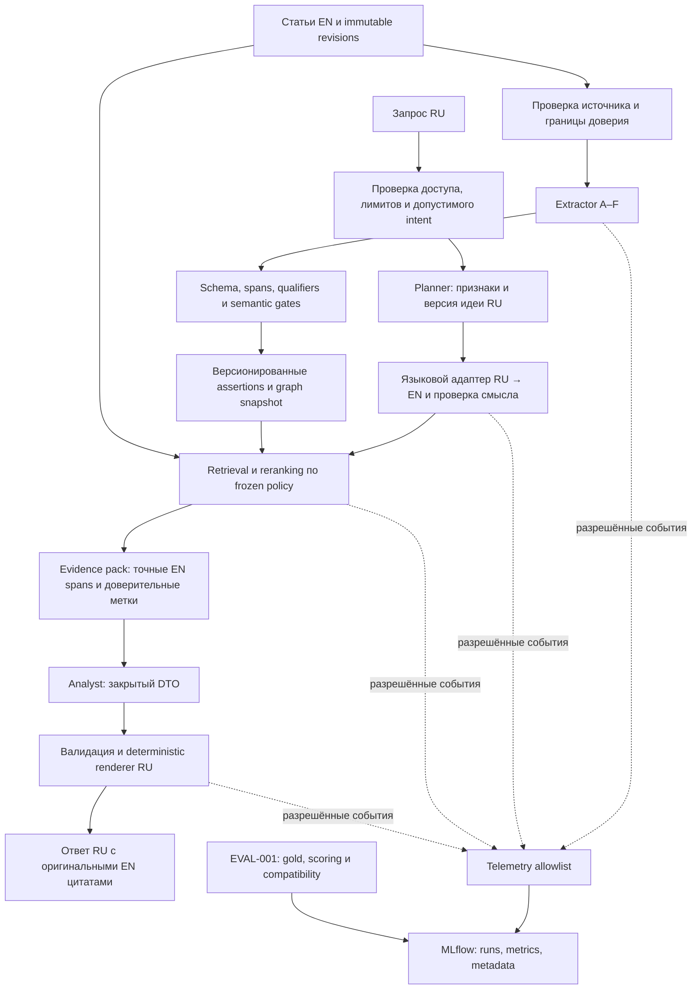

# Дополнение архитектуры: MLflow, минимальные защиты и RU → EN

Дата: **2026-10-21**. Статус: **PROPOSED / NOT_IMPLEMENTED / NOT_RUN**. Это проект архитектуры и будущей оценки. Разметка, установка MLflow, изменение кода/конфигурации, запуск моделей и проверки системы в этой задаче не выполняются.

Дополнение расширяет исходное offline-исследование отдельным языковым контуром для будущего online анализа. Алгоритмы графа A–F сохраняются; наблюдаемость и защиты становятся общими компонентами. Языковой контур оценивается отдельно, чтобы его эффект не приписывался качеству графа.

## 1. Решения и границы компонентов

1. **EVAL-001 вычисляет оценки, MLflow хранит версии экспериментов и показывает сравнения.** Источник результатов — версионированные manifests, gold, outputs и отчёты EVAL. MLflow не заменяет scorer и человеческую разметку.
2. **Все внешние тексты считаются недоверенными данными:** статья, metadata, пользовательский запрос, перевод, retrieved evidence и output модели. Правила доступа, выбор инструментов, публикацию и запись в граф контролирует deterministic shell.
3. **Английские статьи остаются оригиналами.** Извлечение графа, evidence и offsets привязаны к английскому тексту. Для русского запроса создаётся отдельное производное представление на английском; оно не становится фактом источника или новой версией пользовательской идеи.
4. **Русский интерфейс ответа сохраняет оригинальные цитаты.** Объяснения и шаблоны — по-русски; evidence — точные английские excerpts. Перевод цитаты, если понадобится, отображается отдельно и не заменяет evidence.
5. **Наблюдаемость не получает полный текст запросов и ответов.** Только явно разрешённые поля, агрегаты и ссылки на контролируемые артефакты.

Диаграмма описывает будущую целевую систему, а не подтверждённые возможности текущей реализации. При режиме без перевода языковой адаптер сохраняет RU-представление и передаёт его в multilingual retrieval.

### Основания в репозитории

При чтении на HEAD `946f23238e1f01c7477145ad5be66fcc6143eea8`:

- [SECURITY.md](../../SECURITY.md) уже запрещает полные идеи, prompts, raw responses и reasoning в логах/tracing; ADR-011 распространяет запрет на exception bodies и eval artifacts.
- [LLM_CONTRACTS.md](../../LLM_CONTRACTS.md) задаёт закрытые DTO, проверку evidence, ограниченный repair и deterministic renderer. Это сохраняется; свободную генерацию русского финального ответа поверх renderer не добавляем.
- `graph_index.py` уже маркирует chunk как недоверенный текст. В `inference_http.py` prompt передаётся одним сообщением роли `user`. Фраза в prompt не равнозначна отдельным каналам system/data; разделение предстоит специфицировать и проверить по capabilities конкретного provider.
- `config/models.yaml` закрепляет `qwen3-embedding:0.6b`. Документ LLM_CONTRACTS уже называет новых кандидатов Planner/Analyst, тогда как YAML ещё содержит прежние модели. Это расхождение нельзя молча разрешать при сравнении: перед будущими запусками нужны единый inventory и effective manifest. Исторический [аудит](CURRENT_PIPELINE_AUDIT.md) не переписывается как будто он исследовал новый HEAD.

## 2. MLflow: что именно хранить

MLflow поддерживает experiments/runs, параметры, метрики и артефакты. Предлагаем использовать эти возможности как каталог исследовательских запусков; автоматический model registry и новый MLflow judge для первого этапа не требуются. [Официальная документация Tracking](https://mlflow.org/docs/latest/ml/tracking/).

### Единица эксперимента и воспроизводимость

Три независимых research profiles: `graph_extraction`, `crosslingual_retrieval`, `security_regression`. Общий `campaign_id` связывает их. Внутри campaign родительский run хранит manifest сравнения; дочерний run соответствует **одной конфигурации × одному split × одному seed/repeat × одному режиму runtime**. Документы/chunks/cases — строки артефакта, не тысячи отдельных runs. Downstream оценка ссылается на конкретный graph artifact и language policy.

Идентификатор запуска выдаёт shell. Повторная отправка метрик после сбоя не создаёт новый эксперимент. Реальный повтор inference получает новый run и `repeat_id`; изменение gold/scorer требует нового evaluation run с ссылкой на те же predictions. Исторические отчёты можно позднее импортировать только с `origin=historical_import`; отсутствующие версии и метрики остаются неизвестными.

| Группа | Что логировать | Зачем |
|---|---|---|
| Идентичность | `campaign_id`, `eval_run_id`, profile, phase, architecture, timestamps UTC, seed/repeat, run status | Различать эксперимент, повтор и импорт |
| Данные | source/revision manifest hashes, split и gold versions, ontology, annotation rubric, case IDs, scorer/matching versions | Исключать сравнение разных задач и утечки holdout |
| Исполнение | Git SHA и dirty flag, hash разрешённого diff artifact при необходимости, зависимости, OS/CPU/RAM, threads/concurrency, runtime/quantization, cache mode | Повторять условия; SHA без dirty flag недостаточен |
| Модели и правила | effective model digests/revisions и tokenizer, prompt template hash/version, thresholds, dictionaries, guard policy, translation policy и glossary versions | Понимать, какой компонент изменился |
| Бюджеты | context/output caps, deadline, retries, candidate/evidence budgets, batch size, routing threshold | Не приписывать рост ресурсов алгоритму |
| Граф | entity/typing/RE/qualified-RE PRF, candidate recall, SAME precision, contamination, grounding, polarity/qualifier errors, coverage | Качество фактов и полнота, а не только размер графа |
| Поиск/ответ | Recall@K, MRR@K, nDCG@K при graded gold, feature matching, unsupported claims, semantic citation support, fallback/no-evidence rate | Польза для пользовательской задачи |
| Языковой контур | term/number/unit/negation preservation, critical translation errors, unresolved ambiguity, clarification/fallback rate, retrieval delta к human EN reference | Выделять потерю смысла при переводе |
| Защиты | cases attempted/reached/completed, атаки с успешным нарушением по классу, benign false-block rate, quarantine/reject counts и reason codes | Отличать реальную защиту от отказа на всё |
| Производительность | wall/CPU time по стадиям, p50/p95, peak process/host RAM, swap, model load/switch, calls/tokens, encoder passes, retries/timeouts | Считать полный расход, включая translator и guards |
| Диагностика | counts и enum codes для reject/abstain/failure, stage status, tracking status | Разбирать сбои без хранения rejected payload |

Для каждой quality metric сохраняются числитель, знаменатель, `n`, scope/split, averaging и confidence interval с методом расчёта. Метрики и обозначения наследуются из [EVAL design](EVAL001_COMPARISON_DESIGN.md). Нулевой знаменатель не даёт precision=1; `NOT_MEASURED`, `N/A` и `INSUFFICIENT_SUPPORT` сохраняются в status artifact, а не преобразуются в числовой ноль для MLflow. Стоимость API — только при известном тарифе и usage; CPU-seconds не выдаются за денежную стоимость или энергопотребление.

**Артефакты:** manifest сравнения; безопасный effective config без credentials/URLs с секретами; metric definitions и status map; отчёт EVAL; агрегаты/матрицы ошибок; per-case IDs, scalar scores и codes; ссылки и hashes на gold и validated graph artifacts. Публичные source evidence допустимы только по существующей политике доступа и лицензии. Приватные идеи и тексты запросов не дублируются в MLflow. Для повторной оценки используются контролируемые annotation/application stores с отдельным доступом; сам hash приватного текста не делает его анонимным.

### Безопасная телеметрия

Основной режим — **явное логирование metadata и ручные spans без input/output bodies**. Стадии trace: ingress, planner, translate, translation_validate, retrieve, rerank, extract, graph_validate, analyst, render_validate, persist. Поля: непрозрачный ID, stage, duration, outcome, counts, budget и version IDs. Ни argument capture, ни exception message, ни stack locals автоматически не сериализуются. Reasoning отбрасывается на границе provider и не попадает в telemetry buffer.

MLflow умеет захватывать входы/выходы и фильтровать spans до отправки; поэтому включать autotracing без проверки нельзя. Client-side masking — дополнительная защита после allowlist, а не разрешение сначала собирать полный текст. UI preview, span attributes/events, error paths, artifacts и локальная очередь подчиняются той же политике. [Tracing](https://mlflow.org/docs/latest/genai/tracing/), [фильтрация перед экспортом](https://mlflow.org/docs/latest/genai/tracing/observe-with-traces/masking/).

Первое будущее размещение — локальный single-user Tracking с ограниченным доступом, отдельными metadata/artifact stores и закреплённой версией MLflow; конкретный backend и совместимость выбрать в implementation task. Не включать MLflow в пользовательский API и не открывать UI в сеть по умолчанию. Для приватных диагностических metadata предлагается retention 30 дней; публичные исследовательские manifests/агрегаты сохраняются с отчётом. Это проект политики, не выполненная настройка; owner mapping и связанные private artifacts должны поддерживать удаление.

При недоступности MLflow расчёт не повторяется: безопасный локальный manifest/report сохраняется, экспорт получает статус `TRACKING_PENDING` и может быть повторён идемпотентно. Потеря обязательного manifest → `INCOMPLETE`, исключение из итогового рейтинга с сохранением сведений о сбое. Эксперимент не признаётся успешным только из-за MLflow `FINISHED`. Накладные расходы telemetry и flush измеряются отдельно и входят в end-to-end; одинаковая sampling/logging policy у сравниваемых arms.

### Какие запуски можно сравнивать

Compare проверяет profile, source/gold/split/scorer/ontology, non-treatment models/configs, hardware/cache regime для performance и guard/language policies. Для graph experiment меняются extractor и graph snapshot; для language experiment — только языковая policy при фиксированном графе; для guard experiment — только guard policy на изолированных fixtures. Любое дополнительное различие помечается как confound, а не скрывается UI-фильтром. Старые compatibility checks EVAL-001 сохраняются.

## 3. Минимальные защиты: предотвращать действия и проверять результат

Угроза здесь — и прямое изменение правил через запрос, и косвенное через статью/metadata, и перенос инструкции через перевод или graph summary. Защита должна учитывать эти границы, а не только искать фразу «ignore previous instructions». Такой подход соответствует разграничению инструкций и данных и защите нескольких этапов RAG у OWASP. [Prompt Injection Prevention](https://cheatsheetseries.owasp.org/cheatsheets/LLM_Prompt_Injection_Prevention_Cheat_Sheet.html), [RAG Security](https://cheatsheetseries.owasp.org/cheatsheets/RAG_Security_Cheat_Sheet.html).

| Граница | Минимальный будущий guard | Реакция |
|---|---|---|
| Запрос и source ingestion | Ownership, type/size/token limits, deadlines; источники и URL только по allowlist shell; контроль revision/hash | Отклонение нарушенного контракта; текст не управляет fetch |
| Сборка prompt | Отдельные system instructions и сериализованные data blocks там, где provider поддерживает; source IDs и trust labels; отсутствие секретов в контексте | Несовместимый provider — capability failure; никакого повышения роли source text |
| Подозрительная инструкция | Небольшой versioned detector правил для role spoofing, exfiltration и управляющих вставок; проверка до и после перевода | `ALLOW/FLAG/QUARANTINE/BLOCK` с reason codes; detector не объявляет текст безопасным |
| Возможности модели | Translator/extractor/Analyst без shell, arbitrary network и прямой записи в DB; Planner лишь предлагает закрытый intent/DTO | Shell отвергает неизвестные инструменты, IDs, URL и операции |
| Выход и запись графа | Strict schema/enums/limits, exact source spans, domain/range, qualifiers/polarity и отдельная semantic-support проверка | Rejected assertions не публикуются; abstain/partial сохраняют причины и coverage |
| Evidence → ответ | IDs только committed pack, отсутствие новых ссылок/фактов, deterministic RU renderer, безопасный Markdown | Ограниченный repair по текущему контракту; затем validated fallback |
| Логи/артефакты | Allowlist telemetry, запрет raw provider/error/reasoning bodies, изоляция доступа | Небезопасное поле не экспортируется; code/count вместо содержимого |

**Политика подозрений:** `FLAG` означает только сигнал, не автоматическое исключение статьи. Явные управляющие вставки могут давать `QUARANTINE` source window: он не идёт в generative context и не создаёт assertions до review. Оригинал при этом не редактируется; исключение учитывается как потеря coverage. Если безопасных evidence недостаточно, выдаётся ограничение/no-evidence. Превращение подозрительного текста в «чистый» пересказ другой LLM не считается очисткой доверия. `BLOCK` относится к запрещённому действию/нарушению входного контракта, а не к любому упоминанию атак в научной статье.

Проверка Unicode/скрытых символов использует отдельное inspection representation; canonical source и offsets не нормализуются задним числом. Exact quote и валидный JSON могут содержать вредоносную инструкцию или неподтверждённый научный вывод. Semantic verifier тоже ошибается и не получает дополнительных полномочий. Минимальный слой не обещает полного устранения prompt injection; отдельную большую guard-модель пока не вводим.

### Будущая проверка защит

Разметить парные clean/attacked cases: direct RU instruction, EN source injection, metadata/role spoofing, перевод с добавленной инструкцией, graph poisoning, URL/tool request, fake citation и утечка в logs/errors. Для каждого — entry point, ожидаемое разрешённое поведение, запрещённое действие, synthetic canary и attack family. Никаких настоящих секретов или сетевой эксфильтрации: только локальные контролируемые fixtures и имитация эффектов.

`attack_success_rate = случаи с достигнутым запрещённым эффектом / все attempted attack cases`; отдельно показывать reached/completed, detector recall, обход через перевод, correctness законной задачи и false-block rate на clean pairs. Не считать infrastructure failure доказательством защиты и не удалять его из отчёта. Целевой gate — **ноль наблюдаемых критичных нарушений** прав/секретов/действий и отсутствие утечки canary; любой такой случай блокирует соответствующий arm. Это требование набора, а не статистическое доказательство нулевого риска. Допустимую деградацию benign utility фиксировать до holdout, сейчас `UNSET`.

## 4. Языковой контур: сохранять смысл запроса

Для используемого семейства Qwen3 Embedding заявлена поддержка более 100 языков. Это обосновывает включение прямого RU → EN retrieval в baseline, но не доказывает качество русских технических запросов у конкретного закреплённого runtime. [Официальная model card Qwen3-Embedding-0.6B](https://huggingface.co/Qwen/Qwen3-Embedding-0.6B).

### Рекомендуемый проект потока

1. **Planner сохраняет RU intent и признаки с устойчивыми feature IDs.** В многошаговом диалоге remove/replace работает с ID и version, а не с переведённой строкой. Нормализация не меняет исходный запрос.
2. **Language adapter создаёт EN search view** того же запроса и каждого признака. Он может использовать существующий generative provider как отдельную ограниченную роль, однако checkpoint пока не выбран: нужна проверка технического перевода. Повторное использование модели не означает слияние перевода и Planner patch в один непрозрачный ответ.
3. **Glossary + protected spans** фиксируют формулы, марки материалов, аббревиатуры, числа, единицы, диапазоны, отрицания и modality. RU/EN aliases версионируются и связываются с concept IDs только после проверки identity. Совпадение перевода не создаёт `SAME` автоматически. Конвертация единиц — отдельное явное правило с сохранением original value/unit; для первого этапа её не выполнять.
4. **Translation validator** проверяет схему, соответствие feature IDs, отсутствие добавленных/потерянных признаков, protected tokens, отрицания и условий. Эти проверки ловят часть ошибок; semantic equivalence подтверждается human gold, не строковым совпадением или self-confidence переводчика.
5. **Retriever получает утверждённый режим RU/EN**, а Analyst — исходные признаки и validated EN view с теми же IDs плюс оригинальные evidence. Source extraction и английский индекс не переводятся заново при каждом запросе.
6. **Renderer выдаёт русский текст по шаблонам**, сохраняя силу утверждения (`partial/conflicting/uncertain`) и английские цитаты. Если позднее добавляется русский перевод цитат, это отдельное поле presentation с исходным evidence ID и пометкой «перевод»; оно не участвует в exact-offset validation как source quote.

Пример требования: «датчик NO2, не NH3, работающий ниже 50 °C» должен сохранить NO2/NH3, отрицание, границу `< 50`, единицу и связь температуры с режимом работы. «Обнаруживает аммиак» и «поглощает аммиак» не взаимозаменяемы. Это иллюстрации будущей rubric, не готовые размеченные cases.

**Proposed LanguageView contract:** schema/policy version, opaque request/idea version, detected source language, target language, original-reference, `feature_id → translated text + source span alignment`, protected spans, glossary version, model/template identity, status и reason codes. Тексты находятся в scoped application/eval store; MLflow получает только IDs/versions/counts. Статусы: `VALIDATED_BY_RULES`, `AMBIGUOUS`, `INVALID`, `UNAVAILABLE`, `BYPASSED`. Первый статус не означает доказанную эквивалентность смысла.

Непосредственные проверки выполняются перед использованием перевода и после bounded repair, если он предусмотрен policy. Максимум одна repair-попытка в пределах общего deadline/token budget; translator делит generation semaphore с другими ролями. При неоднозначности, меняющей химическое вещество, действие или условие, — clarification. При временной недоступности переводчика разрешён переход к отдельно оценённому T0 с явным degraded status. Если T0 не прошёл gate, fallback — уточнение/недоступность анализа; нельзя молча использовать непроверенный EN текст. Cache включает owner scope, idea version, language/model/glossary/policy identities; source graph от перевода запроса не изменяется.

### Отдельный эксперимент языка

| Arm | Представление запроса | Что проверяет |
|---|---|---|
| T0 | RU напрямую в multilingual retrieval | Базовое качество без стоимости и ошибок перевода |
| T1 | Проверенный EN view с glossary | Помогает ли перевод английскому lexical/graph search и reranking |
| T2 | RU + EN ветви с фиксированным слиянием | Дополняют ли результаты друг друга при допустимой стоимости |
| Tref | Человеческий EN эквивалент того же RU запроса | Ориентир для оценки потерь автоматического перевода, не безусловный верхний предел |

Предварительный основной кандидат — **T1**, T0 обязателен как контроль и возможный fallback. T2 добавляется только при измеримой пользе. Tref — диагностический reference, а не deployment-вариант. Выбор T1 пока гипотеза.

У всех arms один graph/source snapshot, query gold, index/model versions, reranker, final K и evidence budget. Для T2 ограничить суммарное число unique candidates до reranker и учитывать обе retrieval calls; не давать ему удвоенный evidence budget. Ранговое слияние фиксируется заранее; raw scores разных ветвей не складываются без обоснования. Reference EN и парафразы держать в той же split group, что RU запрос.

Метрики: preservation по каждому критичному полю; human semantic adequacy; rate добавленных/потерянных features; Recall/MRR/nDCG и дельта к Tref на тех же cases; качество русского результата и поддержки EN evidence; total latency/CPU/calls; clarification/fallback/coverage. BLEU, обратный перевод или verdict той же модели не заменяют domain review. Пропущенный из-за guard/translation case входит в coverage и end-to-end оценку, а не исчезает из знаменателя.

Предлагаемый gate: ноль наблюдаемых critical meaning changes на контрольном наборе, сохранение всех проверяемых protected tokens и non-inferiority retrieval к T0 в заранее выбранном допуске. Численное значение допуска и minimum coverage пока `UNSET`; их определить на dev до freeze. Для нового переводчика требуется новая оценка и версия policy.

## 5. Что разметим вместе следующим этапом

Сейчас определяем только протокол, без создания gold и без автогенерации меток:

| Набор | Предложение для первого прохода | Что размечается |
|---|---|---|
| Graph gold | Существующий план: 24 abstracts, 12 dev / 6 calibration / 6 locked holdout | EN spans, тип/роль, directed assertion, polarity, условия, identity |
| RU–EN query gold | 30 независимых query intents: 12 dev / 6 calibration / 12 locked holdout, с корректировкой по группам | RU запрос, human EN equivalent, feature alignment, protected terms, ambiguity, relevant docs/spans и graded relevance |
| Guard gold | 24 парных сценария clean/attack: 12 dev / 6 calibration / 6 locked holdout | Entry point, attack family, ожидаемая полезная задача, запрещённый эффект и критерий успеха |

Числа — начальный бюджет пилота, не доказанная статистическая достаточность. Варианты одного intent, source family или attack template не расходятся между splits. При конфликте с 76 untouched graph documents downstream dev cases не раскрывают их gold: dev query evidence ограничить graph development sources, остальное сохранить для locked оценки. Security fixtures отделить от frozen corpus; poisoned тексты не дописываются в исторические 100 документов.

Сначала совместно разобрать два development abstracts и несколько RU intents, уточнить ontology/словарь/rubric и способы разрешения разногласий. Затем закрыть manifest и распределение ролей: пользователь проверяет технический смысл; предложения ассистента остаются draft до human review. Если разметчик один, явно записать `single_annotator` и не заявлять inter-annotator agreement. Для спорных случаев — `UNRESOLVED`, без выдуманной gold certainty. Human EN reference и relevance оцениваются до просмотра outputs новых candidates.

## 6. Порядок будущих работ и ограничения вывода

1. Завершить архитектурные решения, версии контрактов и список открытых gates. **Текущая задача заканчивается на документах.**
2. Следующая отдельная совместная задача — разметка development примеров, rubric, glossary и grouped splits. Реализация для этого не обязательна.
3. После перехода к реализации — EVAL manifest/scorer, allowlisted MLflow adapter и общие guards до первого сравнения моделей. Проверка telemetry leak paths и failure recovery обязательна для этой реализации, но сейчас не запускается.
4. Offline graph pilot и отбор идут по Phases 1–4. Минимальные guards одинаковы для всех кандидатов; их стоимость входит в сравнение.
5. Отдельный language pilot T0/T1/Tref при фиксированном graph; T2 при необходимости. Freeze language policy перед Phase 5, где меняется только graph artifact.
6. При изменении guards/translation после freeze — новый отдельный arm и повтор затронутой оценки. Нельзя объяснить улучшение графом, одновременно сменив переводчик, Analyst и safety policy.

Открытые решения перед запуском: согласованная effective model inventory; translator checkpoint и его license/runtime; glossary/rubric; non-inferiority и coverage limits; ресурсы/retention/backend MLflow. Это пункты будущего выбора, а не повод сейчас устанавливать сервисы или запускать модели. Все quality/performance/security результаты новых компонентов — **NOT_MEASURED**.
